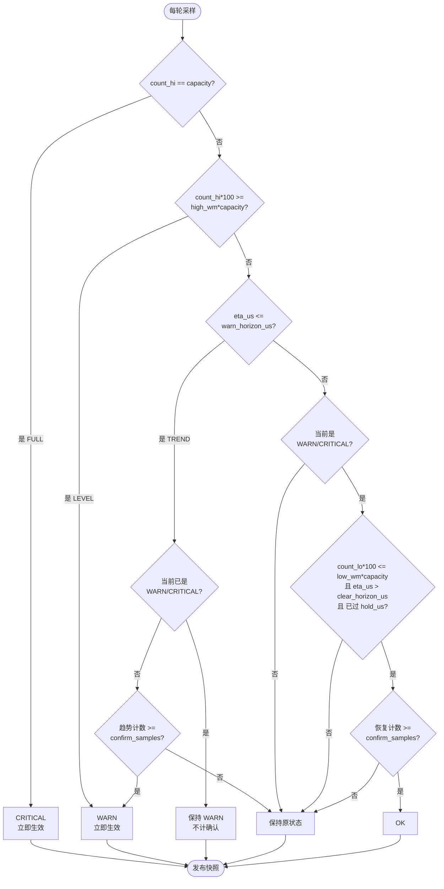
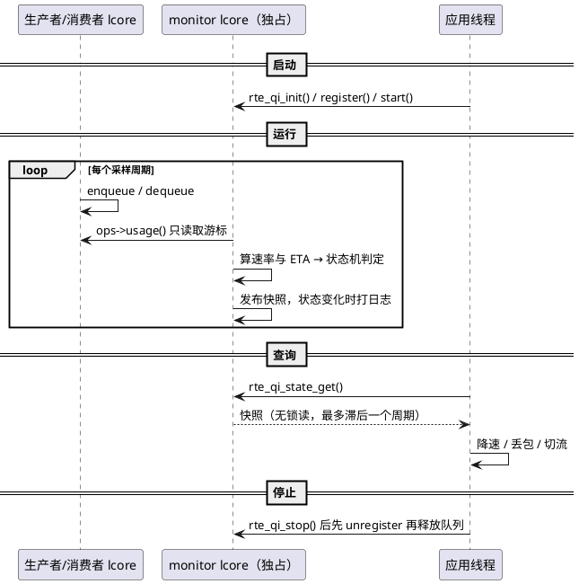

# queue_index模块实现设计

## 修订记录

| 日期       | 修订版本 | 修改描述                                            | 修改人 |
| :--------- | :------- | :-------------------------------------------------- | :----- |
| 2026-11-11 | 1.0      | queue_index 首版实现：采样、预警、查询、验证工具     | xxx    |

## 模块历史需求

| AR ID  | 需求描述                                  | 功能描述                                                                 |
| :----- | :---------------------------------------- | :----------------------------------------------------------------------- |
| QI-001 | pipeline 中队列压满前提前预警           | 独立 lcore 周期采样注册队列，预测填满剩余时间并发布状态标记，应用自行查询 |

## 关键术语

| 关键术语    | 中文名称     | 英文全称             | 详细定义                                                            |
| :---------- | :----------- | :------------------- | :------------------------------------------------------------------ |
| RING        | 环形队列     | Ring                 | DPDK 无锁队列，pipeline 中阶段之间/线程之间的数据通道               |
| SLOT        | 监控槽位     | Slot                 | 注册表中一个被监控队列的内部记录，含配置、窗口和发布快照          |
| count_lo    | 占用下界     | -                    | `prod.tail - cons.tail`，已发布、确定在 ring 中的元素数             |
| count_hi    | 占用上界     | -                    | `prod.head - cons.tail`，含生产者已预留未发布的元素，用于保守告警   |
| NET_PPS     | 净堆积速率   | Net packet rate      | 窗口内入队速率减出队速率，出队更快时按 0 处理                       |
| ETA         | 填满剩余时间 | Estimated time to full | `(capacity - count_hi) / net_pps`，无法预测时为 `RTE_QI_ETA_INFINITE` |

## 模块介绍

pipeline 型 DPDK 应用中，阶段之间、lcore 之间用队列传递 mbuf。入队速率持续高于出队
速率时，队列占用单调上涨直至用满，此后入队失败，报文被丢弃或流水线阻塞。丢包之后再
降速已无法挽回这段报文，应用需要提前一个可配置的时间窗知道"还有多久被压满"。
queue_index 在独立的 monitor lcore 上周期采样队列占用，预测填满剩余时间，并把
`OK / WARN / CRITICAL` 标记发布给应用查询。

### 监控对象

模块把"被监控队列"抽象成一次采样5个数据：

```
struct rte_qi_usage {
    uint32_t capacity;    /* 可用容量 */
    uint32_t count_lo;    /* 已发布占用，下界 */
    uint32_t count_hi;    /* 含预留占用，上界 */
    uint32_t enq_total;   /* 累计入队位置 */
    uint32_t deq_total;   /* 累计出队位置 */
};
```

| 参数 | 含义 | 用途 |
| :--- | :--- | :--- |
| `capacity` | 队列可用容量，即可同时存放的元素个数。`rte_ring` 的 capacity = size - 1（牺牲一格区分空满），不是 size | 把百分比阈值换算成元素个数阈值（`count_hi * 100 >= high_wm * capacity`，交叉相乘不用除法）、判满（`count_hi == capacity`）、ETA 分子（`capacity - count_hi`） |
| `count_lo` | 已发布占用：已入队且对消费者可见的元素个数，是占用的**下界** | 恢复判定（回落到 `low_wm` 以下） |
| `count_hi` | 含预留占用：在 `count_lo` 基础上加上生产者已预留但尚未发布的元素，是占用的**上界** | 三个告警条件：LEVEL（超 `high_wm`）、FULL（等于 `capacity`）、TREND 的 ETA 分子 |
| `enq_total` | 累计入队位置：自 ring 创建以来已发布入队的总数，即 `rte_ring` 的 `prod.tail`| 与窗口内上一次采样做差得到入队速率 `enq_pps`；PEAK/EWMA 逐区间净速率的输入端 |
| `deq_total` | 累计出队位置：累计已完成出队的总数，即 `cons.tail` | 与 `enq_total` 做差得到出队速率 `deq_pps`； |

凡是能回答这五个参数的队列都能被监控。当前有两类：

| 监控对象 | 队列形态 | 计数来源 | 采样成本 |
| :--- | :--- | :--- | :--- |
| 本地 `rte_ring` | 进程内固定深度无锁环 | 直接读 `prod.head / prod.tail / cons.tail` | 约 100 ns（2 条 cache line + 计算） |
| UB 场景下 provider 自己的 rx ring | provider 共享内存中的 `rte_ring`，由 user 经 UB 远端入队 | 同一组计数器，但映射为非 cache 属性，`prod` 侧由远端推进 | 高于本地，量级需实测标定 |

两者的差别只在"怎么读到这五个数"，以及采样周期、预算常数的取值；ETA 定义、状态机、
快照发布、查询接口、日志格式完全一致，应用不需要关心队列来自哪里。UB 队列的采样在
provider 进程内完成，读的是本节点内存，不存在跨节点远端访问。

### 参数计算

| 输出字段 | 含义 | 计算方式 |
| :--- | :--- | :--- |
| `peak_hi` | 窗口内占用上界的峰值，用于判断本窗口内的最高水位 | 窗口内所有样本的 `count_hi` 取最大值 |
| `enq_pps` | 入队速率 | （最新样本 `enq_total` − 最老样本 `enq_total`）÷ 首尾时间差，时间差按 TSC 频率换算 |
| `deq_pps` | 出队速率 | 同上，改用 `deq_total` |
| `net_pps` | 净堆积速率估计，即入队比出队快多少 | 预测器输出：PEAK 取窗口内最大区间净速率、EWMA 平滑、LINREG 拟合斜率；负值钳为 0 |
| `eta_us` | 预计还有多久填满 | `(capacity − count_hi) × 1000000 ÷ net_pps`；队列已满为 0；速率无效（为 0 或低于 `min_net_pps`）为 `RTE_QI_ETA_INFINITE` |
| `state` / `reasons` | 当前状态（OK/WARN/CRITICAL）与本次触发原因（LEVEL/TREND/FULL 位图） | 状态机判定：LEVEL 与 FULL 立即生效；TREND 与 RECOVERY 需连续 `confirm_samples` 次 |
| `warn_ts_ns` / `alarm_count` | 最近一次进入告警的时刻 / 累计进入告警的次数 | 仅在进入 WARN/CRITICAL 时更新，其余时间不变 |
| `capacity` / `count_lo` / `count_hi` / `ts_ns` / `name` | 可用容量 / 已发布占用 / 含预留占用 / 本次采样时刻 / 队列名称 | 不计算：前三项与 `ts_ns` 直接取本轮采样值，`name` 为注册时的 alias |

三种预测算法的计算方式。符号：

- `t_i`：第 i 个样本的采样时刻（TSC 周期）
- `E_i` / `D_i`：第 i 个样本的 `enq_total` / `deq_total`
- `L_i`：第 i 个样本的 `count_lo`
- `f`：TSC 频率（周期/秒）
- `n`：窗口内样本数（2..64）

**PEAK：取窗口内最陡的一个区间**

```
区间净速率  v_k = max(0, ((E_k - E_{k-1}) - (D_k - D_{k-1})) * f / (t_k - t_{k-1}))
            k = 2..n

输出        net_pps = max(v_k)
```

**EWMA：对最后一个区间的净速率做递推平滑，平滑系数固定为 1/2**

```
本轮瞬时值  v   = max(0, ((E_n - E_{n-1}) - (D_n - D_{n-1})) * f / (t_n - t_{n-1}))
递推状态    s   = (s + v) / 2          每轮更新一次（s 初值为 0）
输出        net_pps = max(0, s)
```

**LINREG：对窗口内已发布占用做最小二乘拟合，取斜率（需 n ≥ 3）**

```
x_i = t_i - t_1
y_i = L_i

斜率   k = (n*Σ(x_i*y_i) - Σx_i*Σy_i) / (n*Σ(x_i*x_i) - (Σx_i)^2)
输出   net_pps = k * f
```

三者得到 `net_pps` 后统一走同一条 ETA 规则（见上表 `eta_us` 一行）。`net_pps` 低于
`min_net_pps` 时不产生预测，`eta_us` 为 `RTE_QI_ETA_INFINITE`；LINREG 样本不足 3 个、
或拟合分母不为正、或斜率为负时，同样不输出预测。

### 采样契约

统一入口是注册时绑定的一组回调，核心只通过它取数：

```c
struct rte_qi_queue_ops {
    const char *name;
    int (*check)(void *queue);
    int (*usage)(void *queue, struct rte_qi_usage *u);
};
```

| 字段 | 含义 | 备注|
| :--- | :--- | :--- |
| `name` | 后端名称字符串 | 日志与排查时标识队列来自哪种后端 |
| `check` | 注册时校验回调，可空 | 拒绝不支持的队列（如 RTS 模式的 `rte_ring`）；返回负 errno 则注册失败 |
| `usage` | 每轮采样回调，在 monitor lcore 上执行 | 返回 `capacity/lo/hi/enq_total/deq_total`；返回负 errno 表示本轮观测不到，monitor 跳过该队列、保留上次快照并累加 `sample_errors` | |


### 预测输出

预测器每轮为一条队列输出两个参数，写入快照并供状态机使用：

| 参数 | 含义 | 说明 |
| :--- | :--- | :--- |
| `net_pps` | 净堆积速率估计，单位：元素/秒 | 由选定的预测器给出：PEAK 取窗口内最大区间净速率、EWMA 平滑、LINREG 拟合斜率；出队快于入队时钳为 0 |
| `eta_us` | 预计填满剩余时间，单位：微秒 | 用剩余空间（`capacity − count_hi`）除以 `net_pps`；队列已满为 0；`net_pps` 为 0 或低于 `min_net_pps` 时为 `RTE_QI_ETA_INFINITE` |

两个参数的消费方：

- `eta_us` 用于状态机的 TREND 条件（与 `warn_horizon_us` 比较）和 RECOVERY 条件（与 `clear_horizon_us` 比较）
- 两者都写入快照供应用查询；`net_pps` 与 `eta_us` 来自同一预测器，保证对外数据自洽

### 状态转移

每条队列独立维护一个状态，每轮采样后按下面流程判定一次：



判定要点：

| 条件 | 触发阈值 | 是否需确认 | 依据字段 |
| :--- | :--- | :--- | :--- |
| LEVEL | `count_hi*100 >= high_wm*capacity` | 否，立即 | `count_hi`（上界） |
| FULL | `count_hi >= capacity` | 否，立即 | `count_hi`（上界） |
| TREND | `eta_us <= warn_horizon_us` | 是，`confirm_samples` 次 | `eta_us` |
| RECOVERY | 同时满足低水位、`eta_us > clear_horizon_us`、已过 `hold_us` | 是，`confirm_samples` 次 | `count_lo`（下界）+ `eta_us` |

`reasons` 是**本拍触发条件的位图**（LEVEL/TREND/FULL），不做确认滤波；`state` 是**经确认、
滞回与 `hold_us` 之后的判定结果**。因此可能出现 `reasons` 带 TREND、而 `state` 仍为 OK 的
情况（趋势刚命中，确认次数未满）。

### 工作过程

1. **注册**：应用把需要关注的队列注册进来，为每条队列绑定后端回调，并可按需覆盖
   高/低水位、采样周期、窗口长度、确认次数、预测器等参数，未覆盖字段继承全局 kvargs
   配置。库为每条队列分配一个 slot，保存配置、采样窗口和对外快照；注册表编译期固定
   256 项，运行期不再分配内存。注册时调用一次 `usage()` 固化容量，同时完成可用性校验。
2. **采样**：`rte_qi_start()` 在独占的 EAL lcore 上拉起 monitor 循环。到达某条队列的
   采样点后，调用其后端的 `usage()` 取得 `capacity / count_lo / count_hi / enq_total /
   deq_total`，其中 `count_lo` 是已发布、确定在队列中的元素数（下界），`count_hi` 含
   生产者已预留但尚未发布的元素（上界）。采样不加锁、不做 RMW，不改变队列状态。
3. **估计**：一个采样窗口内按上一节的公式算出 `enq_pps`、
   `deq_pps`、`net_pps` 与 `ETA`。三种预测器对应三类典型故障：PEAK 响应最快，适合下游
   阶跃停摆；EWMA 抑制突发造成的误报；LINREG 适合深队列上的缓慢失配。
4. **判定与发布**：状态机把 LEVEL、TREND、FULL 三个触发条件合成为
   `OK / WARN / CRITICAL`。LEVEL 与 FULL 立即生效；TREND 需连续 `confirm_samples` 次
   成立才升级，滤除单点毛刺。恢复必须同时满足低水位、ETA 回升、最短保持时间三个条件，
   再连续确认，用滞回加保持时间消除状态抖动。每轮采样后用 seqlock 刷新该队列的发布
   快照；状态真正迁移时递增全局 `generation`，并按 `log_rate` 限流打印一条迁移日志。

```
        producer lcore                 monitor lcore (独占, 纯自旋)
   ┌───────────────────┐          ┌──────────────────────────────────────────┐
   │ enqueue           │          │ ops->usage() → capacity/lo/hi/totals     │
   │   ↓               │  队列    │   ↓                                      │
   │ [================]│◄─────────│ 速率窗口(enq/deq) → 预测器(PEAK/EWMA/     │
   │   ↑               │  只读    │ LINREG) → ETA → 状态机(水位/趋势/满)      │
   └───────────────────┘          │   ↓                                      │
        consumer lcore            │ seqlock 发布快照 + 迁移日志(限流)         │
                                  └──────────────┬───────────────────────────┘
                                                 │ 单写
                                       ┌─────────▼─────────┐
                                       │ slot[0..255] 快照 │
                                       └─────────┬─────────┘
                                                 │ 多读无锁
                                  ┌──────────────▼────────────────┐
                                  │ 应用任意 lcore：state_get /   │
                                  │ state_list_warn / generation  │
                                  └───────────────────────────────┘
```

### 应用侧

应用只做查询：`rte_qi_state_get()` / `rte_qi_state_get_by_idx()` 在任意 lcore 无锁读取
快照，得到状态、原因位图、占用上下界、入队/出队/净速率、ETA、最近告警时刻和累计告警
次数；`rte_qi_state_list_warn()` 一次取回所有处于 WARN/CRITICAL 的队列；
`rte_qi_generation()` 用于判断自上次查询以来是否发生过任何迁移，避免每轮扫描注册表。
库不执行降速、丢弃、扩容或切流，也不做事件推送（无回调、无 eventfd），处置策略完全由
应用决定。

【who】DPDK 库 `lib/queue_index`（实现主体）

【what】监控队列压力，提前发布压满预警

【where】pipeline 型应用的阶段间队列：进程内 `rte_ring`，以及 UB 场景下 provider
共享内存中的 rx ring

【why】丢包/阻塞发生后再降速(丢弃、切流)为时已晚，需要提前一个采样窗口获知趋势

【how】独立 lcore 按后端契约采样 + 速率预测 + 状态机标记；只读、不改队列、
不做任何处置

【how much】最多 256 条队列，窗口 ≤64 样本，采样周期 ≥5 µs；本地环支持 MT/ST/HTS
同步模式，不支持 RTS；UB 队列的周期与预算常数按非 cache 采样成本实测确定。两类队列
均不推送（无回调/eventfd），不支持跨进程共享标记

## 模块依赖

| 模块      | 描述                                                              |
| :-------- | :---------------------------------------------------------------- |
| rte_ring  | 提供 `prod.head/prod.tail/cons.tail` 等内部计数器（只读访问），为本地环后端 |
| rte_eal   | monitor lcore 的 `rte_eal_remote_launch`、TSC 频率、lcore 状态     |
| rte_kvargs| `rte_qi_init()` 的全局参数解析                                     |
| rte_log   | 状态迁移日志（带限流）                                             |
| ub_ring（可选）| 提供队列占用的观测接口，供应用侧适配为 `rte_qi_queue_ops`；库不直接依赖它 |

## 模块功能

### 业务功能

| 功能名称                        | 功能说明                                                                 |
| :------------------------------ | :----------------------------------------------------------------------- |
| 统一采样                  | 通过 `rte_qi_queue_ops` 适配本地 `rte_ring` 与 UB rx ring，采样结果归一为 `rte_qi_usage` |
| 周期采样与速率统计              | 每条队列独立 `interval_us`，窗口内统计 `enq_pps / deq_pps / net_pps`     |
| 压满预测（ETA）                 | 三种预测器可切换：PEAK（阶跃）、EWMA（突发）、LINREG（缓漂移）           |
| 状态判定与发布                  | 水位触发、趋势触发、满队列三种条件，带确认次数、滞回、最短保持时间       |
| 状态查询                        | 按名/按 idx 查询快照，`state_list_warn` 批量取告警项，`generation` 去抖  |
| 状态迁移日志                        | 状态变化时输出队列名、前后状态、占用、速率、ETA，并限流                  |

### DFX功能

| 类型       | 功能名称                    | 功能说明                                                                 |
| :--------- | :-------------------------- | :----------------------------------------------------------------------- |
| DFS 可服务性 | monitor 健康信息            | `rte_qi_monitor_status()` 暴露 `running/ticks/missed_ticks/late_ticks/sample_errors/last_tick_ns` |
| DFS 可服务性 | 启动预算校验                | 按各后端声明的 `cost_ns` 求和估算 CPU 占用，超过 `budget_pct` 时 `start()` 返回 `-EINVAL` |
| DFS 可服务性 | 采样失败隔离                | `usage()` 失败时跳过本轮、保留上次快照、累加 `sample_errors`，不产生伪迁移 |
| DFS 可定位性 | 迁移日志限流                | `log_rate`（默认 10 条/秒）+ per-queue 限流，避免日志 I/O 拖住采样         |


## 线程模型分析           
### 并发分析

## 运行分析




## 接口描述

### 关键数据结构

```c
/* 对外发布快照：查询接口按值返回，内容一致但最多滞后一个采样周期 */
struct rte_qi_ring_state {
    char     name[RTE_RING_NAMESIZE];
    enum rte_qi_state state;      /* UNKNOWN / OK / WARN / CRITICAL */
    uint32_t reasons;             /* LEVEL | TREND | FULL 位图 */
    uint32_t capacity;
    uint32_t count_lo;            /* 已发布占用（下界） */
    uint32_t count_hi;            /* 含预留占用（上界） */
    uint32_t peak_hi;             /* 窗口内高边界峰值 */
    uint64_t enq_pps, deq_pps, net_pps;
    uint64_t eta_us;              /* RTE_QI_ETA_INFINITE 表示不收敛 */
    uint64_t ts_ns, warn_ts_ns, alarm_count;
};

/* per-queue 配置：字段为 0 表示继承全局，conf == NULL 表示全部继承 */
struct rte_qi_conf {
    uint32_t high_wm, low_wm;
    uint32_t warn_horizon_us, clear_horizon_us;
    uint32_t interval_us, window, confirm_samples, hold_us;
    uint64_t min_net_pps;
    uint32_t predictor;           /* 0 = 继承全局 */
};

/* 一次采样的归一化结果；后端负责 clamp，使 lo <= hi <= capacity */
struct rte_qi_usage {
    uint32_t capacity;
    uint32_t count_lo;            /* 已发布占用 */
    uint32_t count_hi;            /* 含预留占用，无预留语义时等于 count_lo */
    uint32_t enq_total;           /* 累计入队位置（可回绕） */
    uint32_t deq_total;           /* 累计出队位置（可回绕） */
};

/* 监控后端：核心只依赖这份输入，不感知队列类型 */
struct rte_qi_queue_ops {
    const char *name;
    int (*check)(void *queue);                           /* 注册时校验，可空 */
    int (*usage)(void *queue, struct rte_qi_usage *u);   /* 注册时一次 + 每轮采样，无锁 */
    uint32_t cost_ns;                                    /* 预算估算用 */
};

/* monitor 健康状态：与业务队列状态无关 */
struct rte_qi_monitor_status {
    uint32_t lcore;               /* monitor 所在 lcore，未运行为 UINT32_MAX */
    uint32_t running;
    uint32_t registered;          /* 当前注册队列数 */
    uint64_t ticks;               /* monitor 循环次数 */
    uint64_t missed_ticks;        /* 被跳过的采样周期数 */
    uint64_t late_ticks;          /* 单轮耗时超过一个周期的次数 */
    uint64_t last_tick_ns;        /* 最后一轮完成的时刻 */
    uint64_t sample_errors;       /* usage() 失败次数 */
    uint64_t generation;          /* 全局状态迁移代数 */
};

/* 窗口内的单个样本：每次采样存一行 */
struct qi_sample {
    uint64_t tsc;                 /* 采样时刻（TSC 周期） */
    uint32_t enq_total;           /* 累计入队位置 */
    uint32_t deq_total;           /* 累计出队位置 */
    uint32_t count_lo;
    uint32_t count_hi;
};

/* 内部槽位：seq 与 pub 构成 seqlock，win 为速率窗口环形缓冲 */
struct qi_slot {
    RTE_ATOMIC(uint32_t) seq;     /* 奇数：写入中 */
    RTE_ATOMIC(uint32_t) in_use;
    void *queue;                  /* 后端队列句柄 */
    const struct rte_qi_queue_ops *ops;
    uint32_t capacity;            /* 注册时固化，采样时同步 */
    char name[RTE_RING_NAMESIZE]; /* 注册 alias，发布与日志使用 */
    struct rte_qi_conf conf;
    uint64_t interval_tsc;        /* conf.interval_us 换算成 TSC */
    qi_predict_fn predict;        /* 选定的预测器 */
    int64_t net_ewma;             /* EWMA 递推状态 */
    struct qi_sample win[QI_MAX_WINDOW];
    uint32_t win_head, win_cnt;
    uint32_t prev_state, trend_hits, recovery_hits;
    uint64_t enter_state_ns, next_due_tsc;
    uint64_t alarm_count, warn_ts_ns;
    uint64_t last_log_tsc;
    struct rte_qi_ring_state pub;
} __rte_cache_aligned;
```


### 关键函数

| 函数 | 作用 |
| :--- | :--- |
| `rte_qi_init(kvargs)` | 解析全局参数（lcore / sched / interval_us / window / 水位 / 预测器等），分配 256 个 slot |
| `rte_qi_start()` / `rte_qi_stop()` | 启动/停止 monitor lcore；启动前做 CPU 预算校验，`stop` 等待 lcore 退出 |
| `rte_qi_queue_register(queue, ops, alias, conf)` / `rte_qi_ring_unregister(alias)` | 注册与注销：绑定后端、调 `check()`、探测一次 `usage()` 固化容量；本地环可用 `rte_qi_ring_register*()` 便捷封装 |
| `rte_qi_state_get(name, st)` | 无锁读取单条队列快照，返回 `-ENOENT` 表示未注册/已注销；高频查询用 `state_get_by_idx()` |
| `rte_qi_monitor_status(st)` | monitor 健康信息（`running / ticks / missed_ticks / late_ticks / sample_errors` 等）|

## 开发者测试设计

| 测试设计check维度 | 说明                                                   | 是否涉及 |
| :---------------- | :----------------------------------------------------- | :------- |
| 需求新增功能      | 采样、预测、状态机、查询、日志等新功能需全覆盖         | √        |
| 基础功能          | 注册/注销/查询/启停等基础场景                          | √        |
| 交叉功能          | 与 LRO/大报文等无交叉                                  | ×        |
| 配置文件          | kvargs 参数边界（越界、冲突组合、未知 key）            | √        |
| 资源基线          | 无新增资源基线（固定 256 槽位、运行期不分配）           | ×        |
| 性能              | 需验证 monitor CPU 占用与数据面 pps 影响               | √        |
| 规格              | 256 queue 上限、window/interval 边界、RTS 拒绝           | √        |
| 安全              | 无特权操作、不读写系统文件                             | ×        |


| 测试维度 | 测试场景 | 测试名称 | 测试步骤 | 预期结果 | 能否自动化 |
| :--- | :--- | :--- | :--- | :--- | :--- |
| 接口功能 | 本地 rte_ring | 注册、查询与注销 | 1. 创建 ring 并 `rte_qi_ring_register()`<br>2. `rte_qi_start()`<br>3. `rte_qi_state_get()`<br>4. `rte_qi_ring_unregister()` 后再次查询 | 1. 返回 0<br>2. 返回 0<br>3. 状态由 UNKNOWN 转 OK，`capacity = size-1`<br>4. 返回 `-ENOENT` | √ |
| 接口功能 | 本地 rte_ring | 异常参数与重复注册 | 1. 同名重复注册<br>2. 注册不存在的名字<br>3. 注册 RTS 同步模式的 ring<br>4. 注册 257 条队列 | 1. `-EEXIST`<br>2. `-ENOENT`<br>3. `-ENOTSUP`<br>4. 第 257 条返回 `-ENOSPC` | √ |
| 采样准确性 | 本地 rte_ring | 占用与容量一致 | 1. 单线程入队 N 个报文<br>2. 查询快照并与 `rte_ring_count()` 对比 | `count_lo == count_hi == rte_ring_count()`，`capacity` 与 `rte_ring_get_capacity()` 一致 | √ |
| 计算准确性 | 本地 rte_ring | 速率与 ETA 准确性 | 1. producer 固定 30 Mpps<br>2. consumer 分阶段调速<br>3. 读取 `enq_pps / deq_pps / net_pps / eta_us` | `enq_pps` 与设定速率误差 <1%；停摆场景下 ETA 与实测填满时间误差 ≤50% | √ |
| 计算准确性 | 本地 rte_ring | 状态迁移时序 | 依次执行四阶段：A 无压力预热、B consumer 停摆、C 排空积压、D consumer 降至 29 Mpps | A 阶段告警数 = 0；B 阶段 WARN 早于首次入队失败 ≥50 µs 且出现 CRITICAL；C 阶段 5 ms 内回到 OK；D 阶段走 LEVEL 路径且提前量 ≥1 ms | √ |
| 数据面影响 | 本地 rte_ring | 数据面 PPS 影响 | 同一流量分别关闭 / 开启 monitor，对比数据面 pps | 开启后 pps 下降 <1% | ×（需发包仪） |
| 接口功能 | UB rx ring | 注册与查询 | 1. provider 进程以 `--ub` 模式启动<br>2. 按 `rte_ub_ring_get_total_queues()` 逐条注册 rx 队列<br>3. 查询任一条快照 | 全部注册成功；alias 唯一可区分 provider 与队列号；`capacity = rx_ring_depth - 1` | √ |
| 接口功能 | UB rx ring | 观测失败隔离 | 1. 运行中对 `usage()` 注入失败<br>2. 持续观察状态与 `sample_errors` | 状态保持上一次快照不变；`sample_errors` 递增；不产生迁移日志 | √ |
| 采样准确性 | UB rx ring | 计数与直接读一致 | 1. 暂停 monitor（`rte_qi_stop()`）<br>2. 同一时刻对比 `count_hi / count_lo` 与直接读 `prod.head / prod.tail / cons.tail` | 两者完全一致，无额外 clamp 偏差 | √ |
| 计算准确性 | UB rx ring | 速率与 ETA 准确性 | 1. user 端固定发送速率<br>2. provider 端控制 `recv_burst` 取走速率<br>3. 读取 `enq_pps / net_pps / eta_us` | `enq_pps` 与发送速率误差 <1%；ETA 与实测填满时间误差 ≤50% | √ |
| 数据面影响 | UB rx ring | provider 收包吞吐 | 对比开启 / 关闭 monitor 时的 `recv_burst` 吞吐与丢包计数 | 吞吐下降 <1%，无新增 buffer 或队列丢包 | × |

## 附录：启动参数

`rte_qi_init()` 通过 kvargs 字符串指定，格式为 `key=value`，逗号分隔。除 `lcore` 外均有默认值。

### 调度与资源

| 参数 | 默认值 | 可选值 / 范围 | 含义 |
| :--- | :--- | :--- | :--- |
| `lcore` | 无（必填） | `0..RTE_MAX_LCORE-1` 或 `auto` | monitor 独占的 lcore；`auto` 取第一个 `WAIT` 状态的 worker 核 |
| `sched` | `spin` | `spin` / `sleep` / `hybrid` | 采样间隔的等待方式；10 µs 级周期必须用 `spin` |
| `interval_us` | 10 | ≥ `min_interval_us`，≤ 1000000 | 全局默认采样周期，可按队列覆盖 |
| `min_interval_us` | 5 | 正整数 | 采样周期下限保护，`interval_us` 低于此值则 `init()` 失败 |
| `spin_us` | 0 | 0 ~ 100000 | 仅 `sched=hybrid` 生效：先睡到 deadline 前这么多微秒再自旋；0 表示 `min(interval_us/4, 50)` |
| `stagger` | 1 | 0 / 1 | 是否把各队列的采样相位错开，降低同一时刻的集中 cache line 争用 |
| `budget_pct` | 50 | 1 ~ 100 | monitor 允许占用的单核百分比；启动时按 `cost_ns` 与各队列周期估算，超出则 `start()` 失败 |

### 判定参数（可被 per-queue 配置覆盖）

| 参数 | 默认值 | 可选值 / 范围 | 含义 |
| :--- | :--- | :--- | :--- |
| `window` | 8 | 2 ~ 64 | 速率窗口样本数，决定平滑程度与观测跨度（约 `window × interval_us`） |
| `high_wm` | 50 | 1 ~ 99 | 高水位百分比，占用上界超过即判 LEVEL，立即进 WARN |
| `low_wm` | 25 | 0 ~ 98，且 < `high_wm` | 低水位百分比，占用下界低于此值才允许恢复 |
| `warn_horizon_us` | 150 | 1 ~ 1000000 | ETA 告警阈值，预测填满时间小于此值即判 TREND |
| `clear_horizon_us` | 300 | > `warn_horizon_us` | ETA 恢复阈值，预测填满时间回升到此值以上才允许恢复 |
| `confirm_samples` | 2 | 1 ~ 64 | TREND 与 RECOVERY 需连续命中的次数，用于滤除单点毛刺 |
| `hold_us` | 0 | ≥ 0 | 进入 WARN/CRITICAL 后最短保持时间，期间不判恢复，用于抑制抖动 |
| `min_net_pps` | 100000 | ≥ 0 | 最小净堆积速率门限，低于此值不产生 ETA 预测（结果为无穷） |
| `predictor` | `peak` | `peak` / `ewma` / `linreg` | 全局默认预测器：PEAK 响应快、EWMA 抗突发、LINREG 适合缓慢漂移 |

### 日志

| 参数 | 默认值 | 可选值 / 范围 | 含义 |
| :--- | :--- | :--- | :--- |
| `log` | 1 | 0 / 1 | 是否在状态迁移时输出日志 |
| `log_rate` | 10 | 0 ~ 100000 | 日志限流，单位：条/秒 |

### 注意事项

- 未知 key、类型错误或取值越界时，`rte_qi_init()` 返回 `-EINVAL` 并打印具体 key；
- `low_wm >= high_wm`、`clear_horizon_us <= warn_horizon_us` 视为配置冲突，同样返回 `-EINVAL`；
- 未指定 `lcore` 时 `init()` 成功，但 `rte_qi_start()` 返回 `-ENOENT`；
- 判定参数在注册队列时可在 `struct rte_qi_conf` 中按队列覆盖，字段为 0 表示继承全局值。
